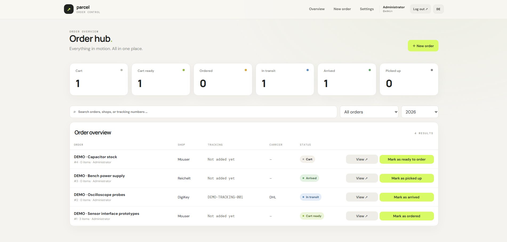
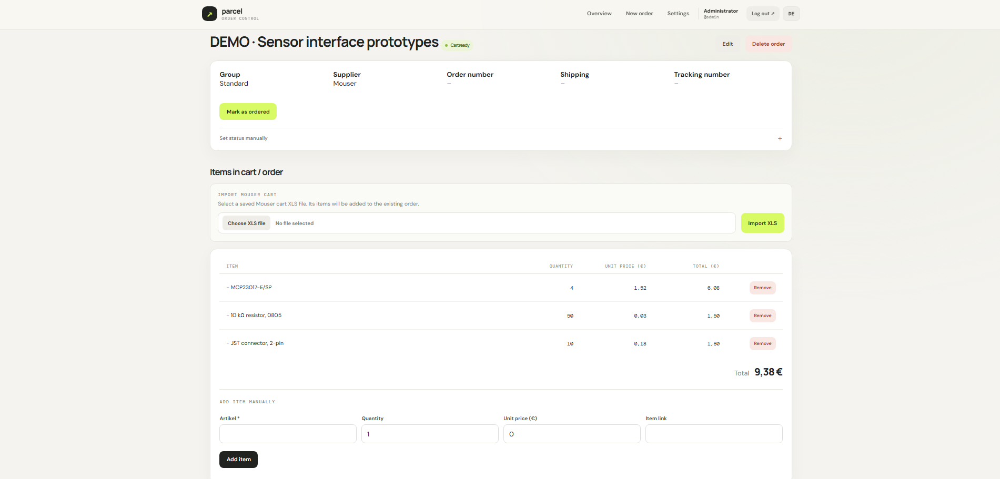
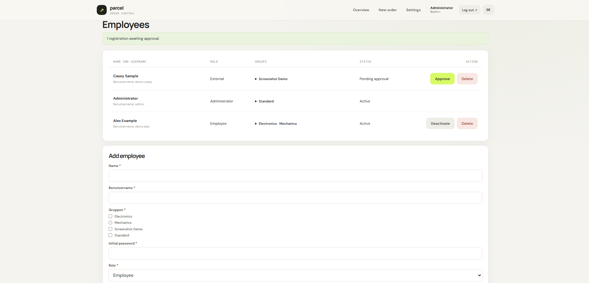

* * *

<div align="center">

<br>
<a href="https://git.io/typing-svg"></a>


</div>

* * *

## 🚀 Overview

**Parcel Desk** is a self-hosted web application for managing shared shopping carts and orders. It keeps order details, items, delivery progress, user activity, and group access in one place.

The application is designed for a small team using a shared internal service. Employees can register themselves, while an administrator approves accounts and assigns them to one or more groups. Each order belongs to one group; employees can see orders from every group they belong to, and administrators can see all orders.

The interface is available in **English and German**. English is the default for new browsers, and each browser remembers its selected language across reloads.

### Why Parcel Desk exists

* Make shared purchasing and order progress visible to the right people.
* Keep item lists, suppliers, carriers, and tracking numbers with each order.
* Let a team mark a shopping cart ready for ordering without losing its history.
* Import saved Mouser carts instead of re-entering each item.
* Notify a private Telegram admin chat about registrations and key order changes.

* * *

## 🧱 Architecture

```text
team members' browsers
  German / English web interface
  registration, orders, items, tracking

Docker Compose service
  Flask application served by Gunicorn
  SQLite database in a persistent Docker volume
  optional Telegram Bot API notifications
```

Application code, templates, styles, and import logic live under `src/`. The Docker image runs as an unprivileged user. Persistent application data is stored in the `order-data` volume.

* * *

## 📸 Screenshots

### Dashboard



<details>
<summary>Order details</summary>



</details>

<details>
<summary>Team management</summary>



</details>

* * *

## ✨ Feature Highlights

### Orders and shopping carts

* Create and edit orders with a required description and supplier or shop.
* Store order numbers, links, notes, carriers, and tracking numbers.
* Add items manually with quantities, unit prices, and item links.
* Review the order activity history, including who changed the status and when.
* Search orders as you type and filter by status and year.

### Order workflow

```text
Cart → Cart ready → Ordered → In transit → Arrived → Picked up
```

* Mark the cart ready when it can be ordered.
* When moving an order to **In transit**, enter its tracking number and carrier if not already recorded.
* If a tracking number is already present, mark the order in transit directly without reopening the tracking dialog.
* When marking an order as **Picked up**, record who collected the package, where it was delivered, and where the delivery note and invoice were left. All three details are required and saved with the order.
* Set a status manually when the normal next step does not apply; marking an order as picked up still requires the pickup details.

### Mouser XLS import

Import a saved Mouser shopping cart in `.xls` format into an existing order. Imported items are added to the order's current item list.

### Accounts, roles, and groups

* Users register with a username, password, and either the **Employee** or **External** role.
* New accounts remain pending until an administrator approves them.
* Administrators assign groups before approving access. Users cannot choose their own groups during registration.
* A user can belong to multiple groups. Each order is assigned to one group.
* Administrators manage users, groups, defaults, and application settings.

### Telegram notifications

When configured, a private Telegram chat receives formatted notifications for:

* New registrations awaiting review and group assignment.
* Orders marked **Cart ready**.
* Orders marked **Picked up**.

Order notifications include the order name, supplier, group, and tracking number when one is available. Administrators can choose English or German under **Settings → Telegram notifications**. Notifications are sent only to the configured chat ID.

* * *

## ⚙️ Getting Started

### Requirements

* Linux server with Docker Engine and the Docker Compose plugin.
* A modern browser for each team member.

### Configure and start

Run these commands from the `paketverwaltung` directory:

```bash
cp .env.example .env
python3 -c 'import secrets; print(secrets.token_urlsafe(48))'
```

Copy the generated value into `SECRET_KEY` in `.env`. Set a strong `ADMIN_PASSWORD` of at least 12 characters. Then start the service:

```bash
chmod 600 .env
docker compose up -d --build
```

By default, the app is available on the server at **http://127.0.0.1:8000**. Sign in using `ADMIN_USERNAME` and `ADMIN_PASSWORD` from `.env`. Initial administrator credentials are used only when the database is created for the first time.

### Local network access

To make the service available on the local network, set this in `.env`:

```env
BIND_ADDRESS=0.0.0.0
```

Restart the service with `docker compose up -d`, then open `http://SERVER-IP:8000`. Use this only on a trusted network because HTTP is unencrypted. For internet access, place the app behind an HTTPS reverse proxy, set `COOKIE_SECURE=true`, and use appropriate access controls. Do not expose port 8000 directly to the internet.

* * *

## 🤖 Telegram Setup (Optional)

1. Create a bot with [@BotFather](https://t.me/BotFather).
2. Create a private Telegram group for the intended administrators and add the bot.
3. Find the group's chat ID. It is usually a negative number for a group.
4. Set both values in `.env`:

   ```env
   TELEGRAM_BOT_TOKEN=your_bot_token
   TELEGRAM_CHAT_ID=your_group_chat_id
   ```

5. Rebuild and start the app, then open **Settings → Telegram notifications** and send a test message.

The bot sends notifications only to the configured chat ID. Anyone in that Telegram group can read its notifications. Treat the bot token as a secret: do not commit it, share it, or include it in screenshots. Telegram bot messages are delivered through Telegram's cloud service, so send only information appropriate for that service.

* * *

## 💾 Data and Backups

The SQLite database is stored in the persistent Docker volume `order-data`. To create a consistent backup, stop the service briefly and archive the volume:

```bash
docker compose stop order-management
docker run --rm \
  -v paketverwaltung_order-data:/source:ro \
  -v "$PWD":/backup \
  alpine tar czf /backup/order-data-backup.tar.gz -C /source .
docker compose start order-management
```

The exact volume name depends on the Compose project name; check it with `docker volume ls`. Store backups separately from the server and periodically test restoring them.

* * *

## 🔐 Configuration and Security

| Variable | Purpose |
| --- | --- |
| `SECRET_KEY` | Flask session signing key; generate a unique random value |
| `ADMIN_USERNAME` | Username for the initial administrator |
| `ADMIN_DISPLAY_NAME` | Display name for the initial administrator |
| `ADMIN_PASSWORD` | Password for the initial administrator; minimum 12 characters |
| `BIND_ADDRESS` | Host interface for the published port; defaults to `127.0.0.1` |
| `PORT` | Host port; defaults to `8000` |
| `COOKIE_SECURE` | Set to `true` when the site is served over HTTPS |
| `TELEGRAM_BOT_TOKEN` | Optional Telegram bot token |
| `TELEGRAM_CHAT_ID` | Optional destination chat ID; notifications stay disabled unless both Telegram values are set |

Keep `.env` private and restrict its file permissions. Server users with root or Docker access may be able to inspect container configuration and secrets, so limit those privileges. Use individual server accounts and avoid sharing administrator credentials.

* * *

## 🧰 Useful Commands

Start or rebuild after changing application code:

```bash
docker compose up -d --build
```

View application logs:

```bash
docker compose logs -f order-management
```

Stop the service:

```bash
docker compose down
```

`docker compose down` keeps the named database volume unless you explicitly remove volumes.

* * *

## 📁 Project Files

| Path | Purpose |
| --- | --- |
| `src/app.py` | Flask routes, database setup, access control, and notifications |
| `src/mouser_import.py` | Mouser XLS parsing |
| `src/templates/` | HTML templates |
| `src/static/` | Styles and browser-side behavior, including language selection |
| `src/requirements.txt` | Python dependencies |
| `Dockerfile` | Application image definition |
| `compose.yaml` | Service and persistent volume configuration |
| `.env.example` | Configuration template |

* * *

## ⚠️ Notes

* Tracking is manual. The application does not call carrier APIs.
* Telegram notifications require outbound HTTPS access to `api.telegram.org`.
* SQLite is intended for small teams. Consider PostgreSQL if the deployment grows substantially.
* This application has not been independently security-audited. Before production internet access, plan for HTTPS, restricted server access, backups, monitoring, and a security review.

* * *

📜 License
----------

This project is licensed under the **Non-Commercial Software License (MIT-style) v1.0** and was developed as an educational project. You are free to use, modify, and distribute the code for **non-commercial purposes only**, and must credit the author:

**Copyright (c) 2026 Darexsh by Daniel Sichler**

Please include the following notice with any use or distribution:

> Developed by Daniel Sichler aka Darexsh. Licensed under the Non-Commercial Software License (MIT-style) v1.0. See `LICENSE` for details.

The full license is available in the [LICENSE](LICENSE) file.

* * *

<div align="center"><sub>Created with ❤️ by Daniel Sichler</sub></div>
